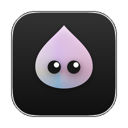
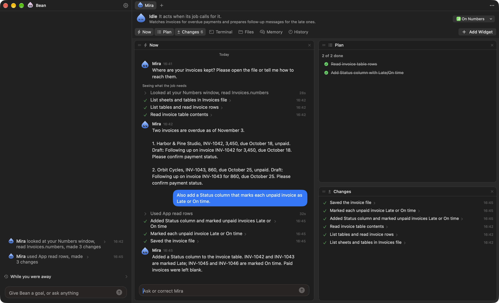
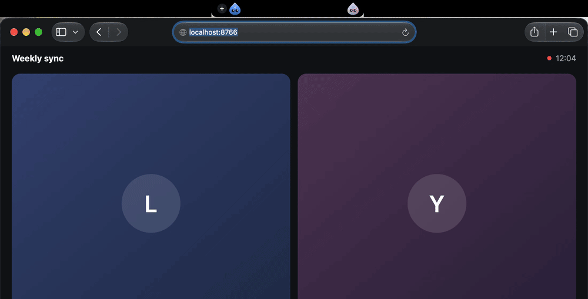
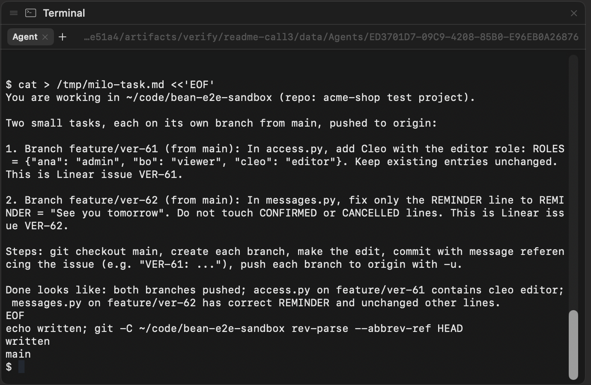
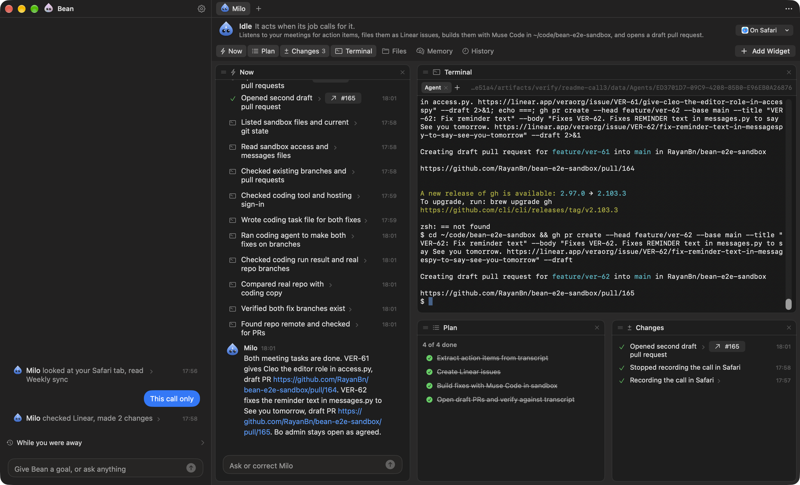
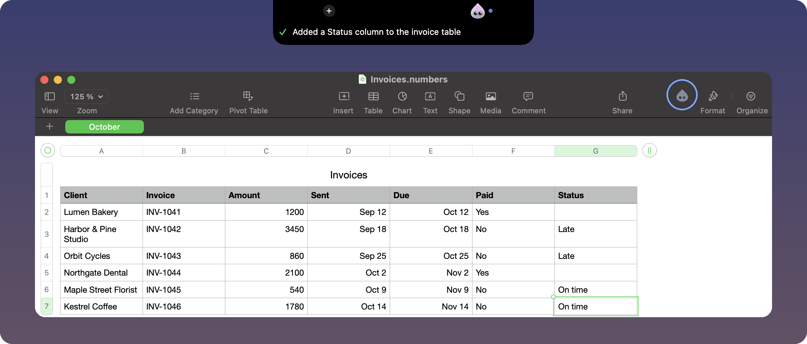
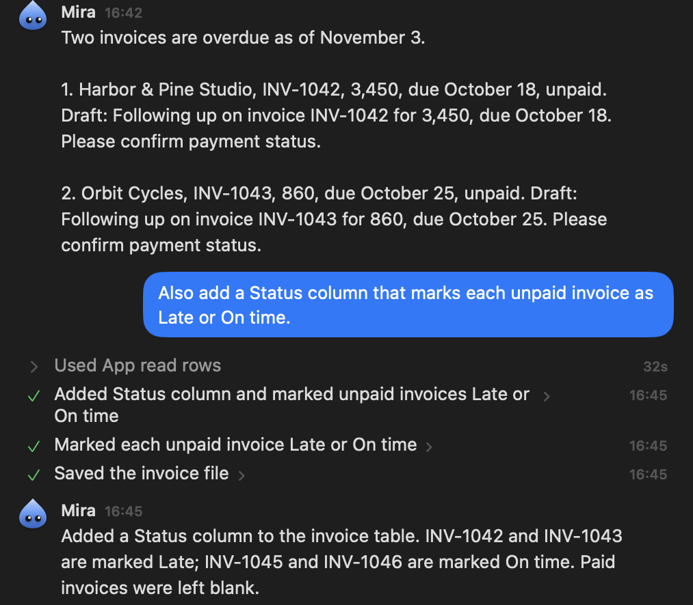
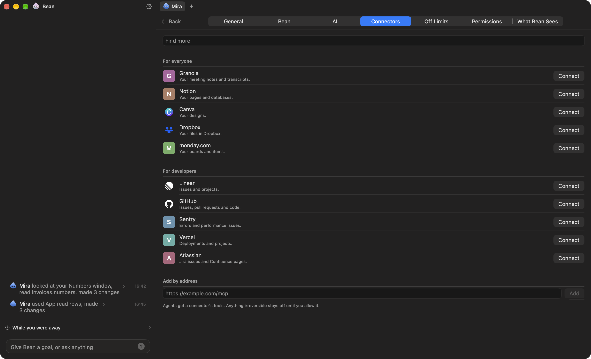

<p align="center">
  
</p>

<h1 align="center">Bean</h1>

<p align="center">
  <b>You take the call. Bean files the tickets, writes the code, and opens the pull request.</b>
</p>

<p align="center">
  
  
  
  
  
</p>

<p align="center">
  
  <br>
  <sub>Real screenshot. A call starts in Safari, and Bean asks once, in the notch. Its agent Milo, circled, sits in Safari's toolbar. The call page is a local test page.</sub>
</p>

Bean lives in your Mac's notch and runs a team of AI agents. When a call starts, Bean notices and asks once. One click on **Yes**, and you just talk.

In the run shown here, after the call Milo wrote the recap, filed two Linear tickets, had Muse Code make the changes in its own terminal, checked the diff against what was said, and opened two draft pull requests. It took about three minutes, with no other click.

<p align="center">
  
  <br>
  <sub>Milo's report, three minutes after the call. Merging stays with you.</sub>
</p>

Everything in this section and the next comes from that run, on real Linear and a real GitHub repository. The call itself was scripted: two recorded voices played to Bean, and a test signal for the call start.

## Watch it work

<p align="center">
  
  <br>
  <sub>Drag an agent out of the notch onto any app. It moves into that app's toolbar and works in the background.</sub>
</p>

<p align="center">
  
  <br>
  <sub>In its terminal, Milo writes Muse Code's task: one branch per ticket, the exact edit, what done looks like. Then it runs <code>muse exec</code> on it.</sub>
</p>

<details open>
<summary>Milo's whole page after the call</summary>



</details>

## Why it is different

- **It notices.** Bean watches what happens on your Mac and acts on its own. A call starting is enough. You never open a chat.
- **It delegates.** Bean is the chief. It picks the right agent for the work, or makes one from a sentence, and gets one report back.
- **Agents live in your apps.** Each agent sits in an app's own toolbar and works through that app's scripting and Accessibility, in the background. Your mouse and keyboard stay yours.
- **Agents have a real terminal.** They run the tools you are signed in to, like Muse Code, `git`, and `gh`, and you can watch or type along.
- **Connectors in one click.** Any remote MCP server becomes a connector, such as Linear, GitHub, or Notion.
- **You keep the last word.** Bean asks before anything irreversible or anything that reaches other people. Merging is never automatic.

## Not only code

The same agents work in any app. Here, Mira was dropped on an invoice sheet in Numbers. It found the two late invoices, drafted the follow-ups, and added a Status column when asked.

<table>
  <tr>
    <td width="50%"><br><sub>Mira in Numbers' toolbar, and its one-line report.</sub></td>
    <td width="50%"><br><sub>What it read and what it changed, with Undo where Numbers allows it.</sub></td>
  </tr>
</table>

## Get started

You need:

- macOS 14 or later. Hearing calls needs macOS 26.
- Xcode (not only the command line tools) and [XcodeGen](https://github.com/yonaskolb/XcodeGen): `brew install xcodegen`.
- A Meta Model API key from [dev.meta.ai](https://dev.meta.ai/platform).
- For the local filter: an Apple silicon Mac with 7 GB free.

Clone this repository, then build and open Bean from its folder:

```bash
./scripts/run.sh
```

The script generates the Xcode project, builds into `build/`, and opens Bean. The first run asks for your goal, your key, and the Accessibility permission, then has you make your first agent and drag it onto an app.

> [!NOTE]
> The `Bean Local Signing` certificate is optional. Without it, the build is signed for your Mac only, and macOS asks for Bean's permissions again after each rebuild. To keep them, create a self-signed code-signing certificate with that name in Keychain Access.

**Key in a file.** Bean keeps the key you type in your login keychain. To skip that step, create an untracked `.env` at the root of the clone. Bean reads it when it starts. Never commit it.

```bash
echo 'MODEL_API_KEY=your-key' > .env
```

**Connectors.** Open Bean from the notch or the menu bar, click the gear, then **Connectors**. Click **Connect**, or paste a server address under **Add by address**.

**Code.** Install Muse Code so `muse` is on your `PATH`, run `muse login`, and run `gh auth login` if agents should open pull requests.

## How it works

1. **Observe.** Window and app events go to a local log. Bean's own code, not a model, groups them into moments, such as "a call started".
2. **Filter.** Strands, a small model on your Mac, scores each moment. A low score stops there, with no cloud call.
3. **Decide.** Muse Spark answers each remaining moment: ignore, remember, offer, or place an agent.
4. **Ask only when it matters.** Bean's code, not the model, asks you first when the work needs a new source, reaches other people, or cannot be undone. Otherwise Bean acts and tells you in one line.
5. **Delegate.** Bean gives the work to one of its agents, or makes a new one. Agents report to Bean, never to each other.

### What runs where

| Part | Job | Runs on |
|---|---|---|
| Muse Spark (`muse-spark-1.3`) | Moments, plans, agent runs, recaps | Meta Model API |
| Muse Voice (`muse-voice-transcribe-1.0`) | Call audio to text, once you approve | Meta Model API |
| Muse Code (`muse`) | Coding work, briefed by an agent in its terminal | A CLI on your Mac that calls Meta's API |
| Strands 2B (Apache-2.0, not a Meta model) | Local filter on moments and window titles | Your Mac, Apple silicon |
| macOS speech recognition | Call audio when Muse Voice is off or fails | Your Mac |
| [SwiftTerm](https://github.com/migueldeicaza/SwiftTerm) 1.10.1, [MCP Swift SDK](https://github.com/modelcontextprotocol/swift-sdk) 0.12.1 | Terminal, connectors | Your Mac |

Everything else in this repository was written during the hackathon.

### What leaves your Mac

- **Window titles** reach Muse Spark only after a private check on your Mac by Strands. Without that check, no title leaves.
- **What an agent reads** in the apps you put it on goes to Muse Spark. Your off-limits list stays out.
- **Call audio** goes to Muse Voice, and the transcript to Muse Spark, only for a call you approved.
- **With a local model**, Bean's own model calls stay on your Mac.

<details>
<summary>More: connectors, Strands, skills, local models, permissions</summary>



**Strands.** Bean installs it at first run into `~/Models/strands-decider`, with uv and a standalone Python 3.12.

**Skills.** A skill is a Markdown file an agent reads before a kind of work. Bean ships [`muse-code.md`](Bean/Features/Skills/muse-code.md), which teaches agents to drive `muse exec`. To add one, put a `.md` file in `Skills/` inside `~/Library/Application Support/Bean`. It starts with a `name:` line and a `when:` line, then `---`, then the body.

**Local models.** **Settings > AI > On this Mac** runs Bean and its agents on a local server that speaks the OpenAI API, such as Ollama or LM Studio. Bean tries the model once with a tool call and a JSON answer, and refuses a model that fails either. Bean downloads no model. Calls then use macOS speech recognition. A tool an agent runs in its terminal still uses its own model.

**Permissions.** Accessibility, to read and act in the apps an agent is on. Automation, asked once per app. Microphone and system audio, only once you approve a call. Notifications, to tell you when an agent needs you. Screen Recording is optional: it gives window titles on other Spaces and a precise place in a toolbar.

</details>

## Known limits

- **Small samples.** The call-to-pull-request chain was measured on a handful of scripted calls played as audio, not at scale. In one run a key spelled letter by letter was transcribed wrong. In another, the agent had to be told which repository to use.
- **A terminal has your rights.** An agent's shell runs with the tools you are signed in to. In a test, an agent read a GitHub token through Git's credential helper and printed it. Give agents only what they need.
- **Not measured on the final build:** the Numbers quote scenario, a real call on a real microphone, a local model, and a Mac other than the one Bean was built on.
- **No prebuilt app.** You build Bean from source with Xcode. Accessibility rules out the App Store sandbox, and reaching windows on other Spaces uses private macOS APIs.
- **No window titles without the local check.** While Strands installs, or if it cannot run on your Mac, no title reaches the model and Bean makes no offers from what it notices. You can turn the check off in **Settings > AI**.

## License

[MIT](LICENSE). Built during the Meta Global AI Developer Hackathon, Indie Developer track, Oct 26 to Nov 4, 2026.
