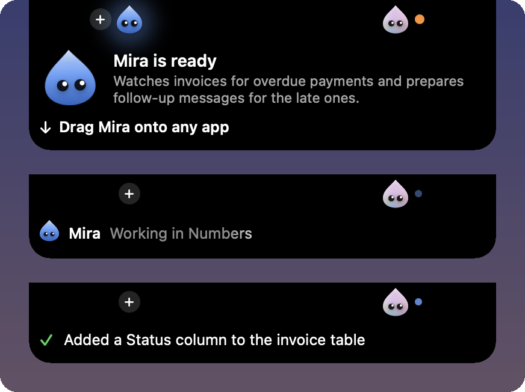

<p align="center">
  
</p>

<h1 align="center">Bean</h1>

<p align="center">
  <b>Describe a task in your Mac's notch. Bean makes an AI agent for it. Drop the agent on an app, and it does the work there.</b>
</p>

<p align="center">
  
  
  
  
</p>

<p align="center">
  
  <br>
  <sub>Real screenshots. The agent, circled, sits in Numbers' own toolbar. It read the invoices, added the Status column, and reported in the notch.</sub>
</p>

<p align="center">
  
  <br>
  <sub>Drag an agent out of the notch and drop it on an app. It takes a place in the app's own toolbar.</sub>
</p>

Say "keep an eye on my invoices and prepare the follow-ups for the late ones". Bean makes an agent from that sentence and names it, here Mira. You drag Mira onto Numbers. It reads the sheet, finds the two late invoices, and drafts the follow-ups on its page. Ask it for a Status column, and it adds one. It works through Numbers' own scripting, so your mouse and keyboard stay yours.

Bean also acts without being asked: it notices what you work on and hands work to its agents. Bean and every agent run on Muse Spark, Meta's model.

## Highlights

- **One sentence makes an agent.** Type after **+** in the notch, then drag the agent onto any app.
- **Agents work in the background.** They use each app's scripting dictionary and Accessibility, not your cursor.
- **Each agent has a real terminal.** It runs the command-line tools you are signed in to, such as Muse Code (Meta's coding agent) and `gh`.
- **Any MCP server is a connector.** Sign in once with OAuth, and agents get its tools.
- **Irreversible actions stay off until you allow them.**

## What leaves your Mac

- **Window titles** reach Muse Spark only after a private check on your Mac by Strands, a small local model. Without that check, no title leaves.
- **What an agent reads** in the apps you put it on goes to Muse Spark. Your off-limits list stays out.
- **Call audio** goes to Muse Voice, and the transcript to Muse Spark, only for a call you approved.
- **With a local model**, Bean's own model calls stay on your Mac.

## Screenshots

<p align="center">
  
  <br>
  <sub>The notch shows only status: a new agent, the agent at work, its one-line report.</sub>
</p>

<p align="center">
  
  <br>
  <sub>An agent's page: what it read, what it changed, and its plan.</sub>
</p>

## Get started

You need:

- macOS 14 or later. Hearing calls needs macOS 26.
- Xcode (not only the command line tools) and [XcodeGen](https://github.com/yonaskolb/XcodeGen): `brew install xcodegen`.
- A Meta Model API key from [dev.meta.ai](https://dev.meta.ai/platform).
- For the local filter: an Apple silicon Mac with 7 GB free.

Clone this repository, then build and open Bean from its folder:

```bash
./scripts/run.sh
```

The script generates the Xcode project, builds into `build/`, and opens Bean. The first run asks for your goal, your key, and the Accessibility permission. Then you make your first agent and drag it onto an app.

> [!NOTE]
> The `Bean Local Signing` certificate is optional. Without it, the build is signed for your Mac only, and macOS asks for Bean's permissions again after each rebuild. To keep them, create a self-signed code-signing certificate with that name in Keychain Access.

**Key in a file.** Bean keeps the key you type in your login keychain. To skip that step, create an untracked `.env` at the root of the clone before you build. Never commit it.

```bash
echo 'MODEL_API_KEY=your-key' > .env
```

**Connectors.** Open Bean from the notch or the menu bar, click the gear, then **Connectors**. Click **Connect**, or paste a server address under **Add by address**.

**Coding work.** Install Muse Code so `muse` is on your `PATH`, and run `muse login`. Run `gh auth login` too if agents should open pull requests.

## Three things to try

| You set up | You say | The agent |
|---|---|---|
| An invoice sheet in Numbers | "Keep an eye on my invoices and prepare the follow-ups for the late ones." | Finds the late invoices and drafts a follow-up for each. You send them: agents never message people. |
| A quote sheet in Numbers, hotel pages in your browser | "Fill the quote with the hotels I have open: price per night and total." | Reads the tabs, writes the rows, reads them back, and leaves computed cells alone. |
| Linear connected, a repository on disk | "After our calls, file the tasks in Linear, make the changes with Muse Code, and open a draft pull request." | Hears the call once you approve, files the tickets, runs `muse exec` in its terminal, checks the diff against the transcript, and opens a draft pull request. |

## How it works

1. **Observe.** Window and app events go to a local log. Bean's own code, not a model, groups them into moments, such as "a call started".
2. **Filter.** Strands scores each moment on your Mac. A low score stops there, with no cloud call.
3. **Decide.** Muse Spark answers each remaining moment: ignore, remember, offer, or place an agent.
4. **Ask only when it matters.** Bean's code, not the model, asks you first when the work needs a new source, reaches other people, or cannot be undone. Otherwise Bean acts and tells you in one line.
5. **Delegate.** Bean gives the work to one of its agents, or makes a new one. Agents report to Bean, never to each other.

An agent sits in a free spot of the app's toolbar, as a small Bean window placed there. With no room, it waits in the notch with the app's icon.

### What runs where

| Part | Job | Runs on |
|---|---|---|
| Muse Spark (`muse-spark-1.3`) | Moments, plans, agent runs, recaps | Meta Model API |
| Muse Voice (`muse-voice-transcribe-1.0`) | Call audio to text, once you approve | Meta Model API |
| Muse Code (`muse`) | Coding work, typed by an agent in its terminal | A CLI on your Mac that calls Meta's API |
| Strands 2B (Apache-2.0, not a Meta model) | Local filter on moments and window titles | Your Mac, Apple silicon |
| macOS speech recognition | Call audio when Muse Voice is off or fails | Your Mac |
| [SwiftTerm](https://github.com/migueldeicaza/SwiftTerm) 1.10.1, [MCP Swift SDK](https://github.com/modelcontextprotocol/swift-sdk) 0.12.1 | Terminal, connectors | Your Mac |

Everything else in this repository was written during the hackathon.

<details>
<summary>More: connectors, Strands, skills, local models, permissions</summary>


**Strands.** Bean installs it at first run into `~/Models/strands-decider`, with uv and a standalone Python 3.12. It needs an Apple silicon Mac and 7 GB free.

**Skills.** A skill is a Markdown file an agent reads before a kind of work. Bean ships [`muse-code.md`](Bean/Features/Skills/muse-code.md). To add one, put a `.md` file in `Skills/` inside `~/Library/Application Support/Bean`. It starts with a `name:` line and a `when:` line, then `---`, then the body.

**Local models.** **Settings > AI > On this Mac** runs Bean and its agents on a local server that speaks the OpenAI API, such as Ollama or LM Studio. Bean tries the model once with a tool call and a JSON answer, and refuses a model that fails either. Bean downloads no model. Calls then use macOS speech recognition. A tool an agent runs in its terminal still uses its own model.

**Permissions.** Accessibility, to read and act in the apps an agent is on. Automation, asked once per app. Microphone and system audio, only once you approve a call. Notifications, to tell you when an agent needs you. Screen Recording is optional: it gives window titles on other Spaces and a precise place in a toolbar.

</details>

## Known limits

- **Small samples.** On the final build, the call-to-pull-request scenario ran twice with a scripted call played as audio. One run was right in full. In the other, a key spelled letter by letter on the call was transcribed wrong, and the code carried the wrong key.
- **Not measured on the final build:** the Numbers quote scenario, a real call on a real microphone, a local model, and a Mac other than the one Bean was built on.
- **No prebuilt app.** You build Bean from source with Xcode. Accessibility rules out the App Store sandbox, and reaching windows on other Spaces uses private macOS APIs.
- **No window titles without the local check.** While Strands installs, or if it cannot run on your Mac, no title reaches the model and Bean makes no offers from what it notices. You can turn the check off in **Settings > AI**.

## License

[MIT](LICENSE). Built during the Meta Global AI Developer Hackathon, Indie Developer track, Oct 26 to Nov 4, 2026.
