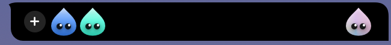
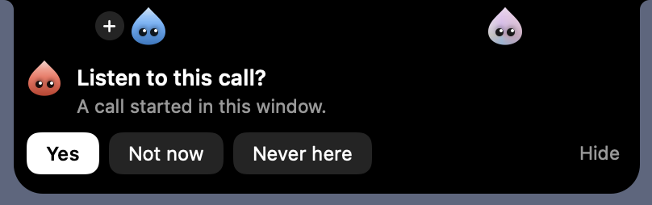
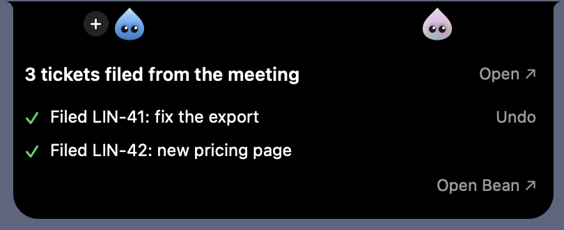
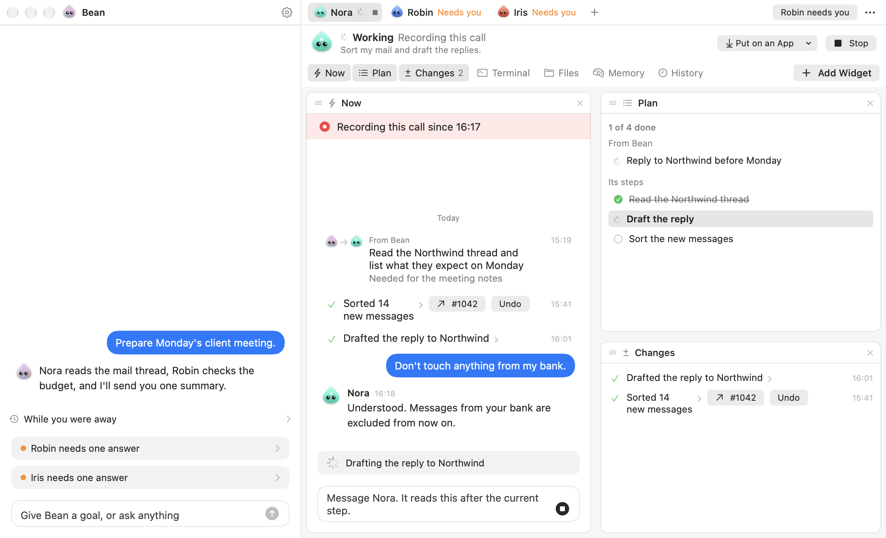

# Bean

Bean is a chief that lives in your Mac's notch. It watches what happens on your Mac, works out what would help, and puts agents on your apps to do the work. Agents work in the background, without your mouse or keyboard, and Bean reports once, when there is something to say.

Built for the Meta Global AI Developer Hackathon, Indie Developer track, between Oct 26 and Nov 4, 2026. Muse Spark is the brain of Bean and of every agent.



## How it works

### The chief

1. **Bean observes.** Window and app events go to a local log, with no model call. Code turns them into moments, such as "a call started" or "you came back to this window".
2. **A local filter drops most moments.** Strands, a small model that runs on your Mac, scores each moment and each window title. A low score ends there, with no cloud call.
3. **Muse Spark decides.** It gets one short call per moment that passes and answers ignore, remember, offer or place.
4. **Code decides if Bean must ask.** Bean asks first when the work needs a new source, reaches someone else, or cannot be undone. Otherwise it acts and says so in one line, with Undo when there is one.

Bean does not do the work itself. It chooses one of its agents for it, or makes a new one, and hands the work over.

### Agents on apps

An agent sits on one or more apps. You make one from a sentence with "+" in the notch, and drag it onto any app. Putting it on an app is your yes to read everything in that app. Bean can also place agents by itself.

An agent works through the app's own channels: its scripting dictionary, Accessibility, its menus and, for browsers, its tabs. It takes a free place in the app's own toolbar row, as a small window of Bean's placed there. With no room in the bar, it shows in the notch with the app's icon.

Agents never contact each other. They report to Bean.

### From a call to work

When a call starts in a window, the agent on that app asks once in the notch: "Listen to this call?". After a yes, Bean records your side and the other side. When the call ends, the agent writes a recap with the decisions, the tasks and what stays open. Then it does what its job says follows, such as filing tickets or changing code, and compares what it produced with the transcript before it finishes. Bean hears last, with what the agent really did, and judges what else follows.





### Connectors

A connector is a remote MCP server, connected in one click with OAuth in your browser. Settings > Connectors shows a short catalogue (`Bean/Features/Connectors/catalogue.json`), a search of the official MCP registry, and a field to add any server by its address. Bean also lists MCP servers already set up in other tools on your Mac, from the files in `Bean/Features/Connectors/connector-configs.json`. Agents get the tools of a connected connector.

### The terminal

Each agent has one real terminal: a login shell on your Mac, with your PATH and your signed-in command-line tools. The session stays open between the agent's runs, and you can watch it and type in it from the agent's page. Bean's code names no coding tool: an agent that needs one types it in its terminal. When a command it left running ends, the agent gets a new run with the result.

### Skills

A skill is a Markdown file with know-how for one kind of work. An agent sees each skill's name and when to use it, and reads the whole skill with `read_skill` before that work. Bean ships one: `Bean/Features/Skills/muse-code.md`, for driving Muse Code with `muse exec` from the terminal.

To add your own, put a `.md` file in `Skills/` inside Bean's data folder. It starts with a `name:` line and a `when:` line, then a line with `---`, then the body.

### What runs where

| Part | Role | Where it runs | License or owner |
|---|---|---|---|
| Muse Spark (`muse-spark-1.3`), Meta Model API | Bean's moments and plans, every agent's runs, making agents, recaps | Meta's cloud | Meta |
| Muse Voice (`muse-voice-transcribe-1.0`), Meta Model API | Call audio to text, after your yes | Meta's cloud | Meta |
| Muse Code (`muse`) | Coding work, typed by an agent in its terminal | Your Mac, with Meta's models | Meta |
| Strands 2B (`strands-decider-2B-qwen3.5-v1-2610`), run with MLX and PyTorch | Local filter on moments and window titles | Your Mac | Apache-2.0. Not a Meta model |
| uv and a standalone Python 3.12 | Install Strands at first run, in its own folder | Your Mac | Apache-2.0 and MIT. Python Software Foundation |
| macOS speech recognition | Call audio to text when Muse Voice is off or fails | Your Mac | Apple |
| SwiftTerm 1.10.1 | The embedded terminal | Your Mac | MIT |
| MCP Swift SDK 0.12.1 | Connectors | Your Mac | MCP project |

Everything else in this repository was written during the event.



## Requirements

- macOS 14 or later. Hearing calls needs macOS 26.
- Xcode, not only the command line tools.
- [XcodeGen](https://github.com/yonaskolb/XcodeGen): `brew install xcodegen`.
- A Meta Model API key, from https://dev.meta.ai/platform.
- For Strands: an Apple silicon Mac, 7 GB free, a network connection at first run and about 4 GB of memory while it runs.
- For coding work: Muse Code installed, so that `muse` is on your PATH, and signed in with `muse login`. Also the tools your work needs, such as `git` and `gh`, signed in.

Bean asks macOS for these permissions, each when it needs it:

| Permission | Why |
|---|---|
| Accessibility | Read the apps an agent is on and act in them |
| Automation | Drive an app through its own scripting. macOS asks once per app |
| Microphone | Hear your side of a call, after your yes |
| System audio recording | Hear the other side of a call, after your yes |
| Screen Recording | Optional. Window titles on other Spaces, and a picture of an app's bar to place an agent in it |
| Notifications | Tell you when an agent needs you |

Settings > Permissions shows Accessibility, Automation and Notifications, each with a button that opens its pane in System Settings.

## Install and run

```bash
git clone <this repository's URL> Bean
cd Bean
./scripts/run.sh
```

`scripts/run.sh` checks for Xcode and XcodeGen, generates the Xcode project, builds Debug into `build/` and opens Bean. The first build fetches its packages from GitHub. With no `Bean Local Signing` certificate in your keychain, it signs for your Mac only, and macOS asks for its permissions again after each rebuild.

### The model key

The first run asks for your key and checks it. It is stored in your login keychain.

You can also put it in a `.env` file at the root of the clone before you build:

```bash
echo 'MODEL_API_KEY=your-key' > .env
```

`.env` is in `.gitignore`. Never commit it. Bean reads it from the folder it was built from. An environment variable `MODEL_API_KEY` wins over the file, and the file wins over the keychain.

### First run

A small window asks for your objective, the model (Muse Spark in the cloud, or a model on your Mac), and the Accessibility permission. It tells you what Bean sees and lets you close things off. Then you make your first agent from one sentence and drag it onto an app. Once the key passes, Bean installs Strands in the background into `~/Models/strands-decider`.

Bean keeps its data in `~/Library/Application Support/Bean`: agents, memory, journal, settings and connector tokens. Set `BEAN_DATA_DIR` to use another folder.

### Add a connector

1. Click the notch, then **Open Bean**. Or click Bean in the menu bar, then **Open Bean**.
2. Open Settings with the gear, then **Connectors**.
3. Click **Connect** on a service, or type a server address under **Add by address**. Sign in in your browser.

An agent that needs a connector you do not have asks for it by name.

## Three examples

These show what Bean is built for. Only the third was measured end to end on the final build; see Known limits.

**A travel quote in Numbers.** Open the hotel pages in your browser and a quote sheet in Numbers. Make an agent: "Fill the quote with the hotels I have open, prices per night and total." Drag it onto Numbers, then onto the browser. It reads the tabs, writes the rows through Numbers' scripting, reads them back, and leaves alone what the sheet computes. Each change has Undo on the agent's page.

**Invoice follow-ups in Numbers.** With a sheet of invoices open, make an agent: "Check which invoices are late and prepare the follow-ups." It reads the sheet row by row. For each client it offers one draft and two alternatives in the notch, one client at a time. You pick, Bean copies the text, and you send it. Agents never send messages to people themselves.

**A meeting to Linear tickets, code and a draft pull request.** Connect Linear. Make an agent whose job is your project: "After our calls, file the tasks in Linear, make the changes with Muse Code and open a draft pull request." Put it on the app where your calls happen. When a call starts, say yes in the notch. After the call it posts the recap, files the tickets, runs `muse exec` in its terminal on your repository, checks the diff against the transcript, pushes a branch, opens a draft pull request and reports with the links. Merging stays with you.

## Local models

Settings > AI > On this Mac runs Bean and its agents on a model from a local server that speaks the OpenAI API. Bean looks for Ollama, LM Studio, llama.cpp and Jan on their usual ports, and takes any other address. It tries the chosen model once with a tool call and a JSON answer, and does not use a model that fails either. Bean downloads no model itself.

With a local model, Bean's own model calls stay on your Mac, and calls are transcribed with macOS speech recognition instead of Muse Voice. A tool an agent runs in its terminal, such as Muse Code, still uses its own model. Strands stays as it is. The scenarios above were not measured with a local model.

## Known limits

- **Repeat rate.** On the final build, the meeting scenario was run twice with a scripted call played as audio, on a test repository and a test Linear workspace. One run was right in full: tickets, code, draft pull request and report. In the other, a key spelled out letter by letter on the call was transcribed wrong, and the code carried the wrong key. Runs on earlier builds had wrong details in the code. Two runs are a small sample.
- **Not measured on the final build:** the two Numbers scenarios, a real call with a real microphone, a local model on the scenarios, a Mac other than the development one.
- **Merging is off.** No agent can merge or mark a pull request ready, whatever the switches say. Deleting and other irreversible actions stay off unless you turn them on.
- **The agent in the app's bar is Bean's own window placed there.** Nothing enters the app. Without Screen Recording, Bean places it from Accessibility frames only, less precisely.
- **Window titles reach the model after a local private check.** With no check, because Strands is installing, failed or cannot run on this Mac, no window title reaches the model and Bean makes no offers from what it notices. You can turn the check off in Settings > AI.
- **Bean is a local build, not a signed release.** Accessibility rules it out of the App Store sandbox. Reaching windows on other Spaces uses private macOS APIs.
- **Calls need macOS 26.** On earlier versions, Bean says it cannot hear the call.

## License

MIT. See [LICENSE](LICENSE).
